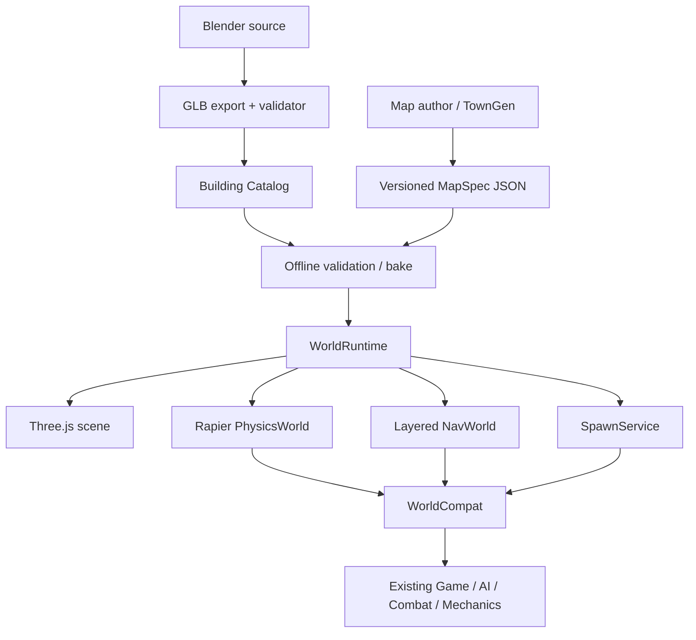

# v4 架构总览

## 目标边界
v4 仅重建地图、建筑资产、碰撞、导航、出生和地图 QA。保留角色、武器、战斗、AI 战术、网络、UI、音效与通用玩法机制；只迁移它们访问地图服务的接口。

## 系统图

## 模块职责
| 模块 | 负责 | 不负责 |
|---|---|---|
| AssetCatalog | 资产 ID、尺寸契约、版本和路径 | 地图坐标 |
| BuildingLoader | VIS/COL/NAV/ANCHOR 节点读取 | 猜测 collider |
| MapSpecLoader | JSON 读取和 schema 校验 | 创建物理/渲染对象 |
| MapBuilder | 同一 transform 实例化 render/physics/nav | 维护第二份 map data |
| PhysicsWorld | Rapier、角色控制器、射线、shape query | 路径搜索 |
| NavWorld | 高度感知寻路、楼层和连接图 | 物理阻挡 |
| SpawnService | 出生/重生安全选点 | 自己实现几何查询 |
| WorldRuntime | 加载/卸载事务和系统生命周期 | 吞并子系统逻辑 |
| WorldCompat | 过渡期旧 API adapter | 作为新系统内部数据源 |

## 坐标和生命周期
- Y-up；X/Z 为地面；1 单位 = 1 米；建筑原点位于 footprint 中心地面。
- 默认实例 scale=1；不设全局 1.3/1.4 倍数。
- load 顺序：停用旧地图引用 → 卸载 nav/physics/render → 校验 MapSpec/Catalog → 创建 render → 建 Rapier COL → 烘焙/加载 NAV → spawn/objectives/mechanics → 轻量完整性校验 → 原子激活。
- 任一阶段失败必须回滚，不可出现画面为新地图而碰撞仍是旧地图的混合状态。
- 卸载需释放 Rapier handles、几何、材质、监听器和路径缓存。

## 兼容接口
过渡层需支持现有调用点：`mapId`、`mapDef`、`scene`、`objects`、`capturePoints`、`capMeshes`、`spawns`、`minimapBg`、`minimapStatic`、`walkable(x,z)`、`heightAt(x,z,currentY?)`、`rayBlocked(from,to)`、`blocksAt(collider,feetY)`、`pickSpawn(team)`、`updateSun(x,z)`。
新代码直接依赖 PhysicsWorld/NavWorld；禁止直接 push/pop 旧式 collider 列表。迁移顺序：combat → AI → game/spawn → mechanics → UI/minimap → mg/items。迁完一组调用就删除对应 adapter。
